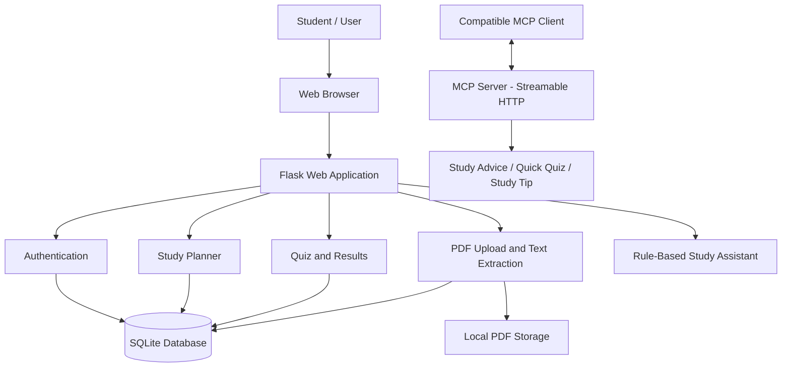

# StudyPilot AI — Intelligent Study Companion

**A student-focused study workspace for organizing learning materials, planning study sessions, practicing quiz questions, and exploring an MCP-powered study assistant.**

<p align="center">
  <strong>Learn Smarter. Stay Organized. Study with Purpose.</strong>
</p>

<p align="center">
  
  
  
  
  
</p>

---

## Table of Contents

- [1. Project Overview](#1-project-overview)
- [2. Problem Statement](#2-problem-statement)
- [3. Proposed Solution](#3-proposed-solution)
- [4. Project Objectives](#4-project-objectives)
- [5. Key Features](#5-key-features)
- [6. System Architecture](#6-system-architecture)
- [7. Technology Stack](#7-technology-stack)
- [8. Model Context Protocol Integration](#8-model-context-protocol-integration)
- [9. Project Structure](#9-project-structure)
- [10. Installation and Setup](#10-installation-and-setup)
- [11. Running the Application](#11-running-the-application)
- [12. Application Workflow](#12-application-workflow)
- [13. Database Design](#13-database-design)
- [14. Security and Privacy](#14-security-and-privacy)
- [15. Current Limitations](#15-current-limitations)
- [16. Future Enhancements](#16-future-enhancements)
- [17. Testing and Validation](#17-testing-and-validation)
- [18. Demo and Screenshots](#18-demo-and-screenshots)
- [19. Hackathon Submission Notes](#19-hackathon-submission-notes)
- [20. Contributing](#20-contributing)
- [21. License](#21-license)
- [22. Author and Project Links](#22-author-and-project-links)

---

## 1. Project Overview

StudyPilot AI is a student-focused study companion designed to bring essential study activities into one organized workspace.

Students often use separate applications to manage their notes, plan their daily study sessions, track pending tasks, and practice questions. StudyPilot AI brings these activities together through a simple, responsive web application.

The project combines a Flask-based web application, a local SQLite database, PDF text extraction, rule-based study assistance, and a separate Model Context Protocol (MCP) server.

The application also includes an Alexa-style simulated web experience to demonstrate how a conversational study assistant could be presented to users.

### Project Highlights

- Student-oriented study dashboard.
- User registration and login.
- PDF upload and extractive text preview.
- Study task and deadline management.
- Practice quiz workflow with score tracking.
- Notes and study assistance.
- Browser-based speech input where supported.
- MCP tools for study advice, quiz prompts, and study tips.
- Local development without requiring a paid generative AI API.

**Project status:** Prototype / hackathon demonstration.

**Important disclosure:** The current assistant uses rule-based responses and extractive text processing. The Alexa-style page is a simulated experience, not a live Alexa+ skill or an official Amazon integration. The MCP server is a separate local service and must be tested with a compatible MCP client before its functionality can be considered verified.

---

## 2. Problem Statement

Students frequently face difficulties managing multiple study activities, including:

1. Organizing learning materials across different locations.
2. Maintaining a consistent study schedule.
3. Tracking pending assignments and revision tasks.
4. Revising uploaded study documents efficiently.
5. Practicing questions and reviewing quiz performance.
6. Accessing study assistance without depending on paid AI services.

Using separate tools for each activity can create unnecessary complexity and make it harder to maintain a consistent study routine.

StudyPilot AI addresses this problem by providing a unified study workspace with a lightweight architecture that can be extended as requirements grow.

---

## 3. Proposed Solution

StudyPilot AI provides a web-based platform where users can organize study materials, maintain tasks, practice questions, and interact with a basic study assistant.

The proposed solution consists of five major components:

- **Study dashboard:** Provides an overview of uploaded documents and pending tasks.
- **Learning materials:** Accepts PDF documents and extracts selectable text for a simple notes preview.
- **Study planner:** Allows users to create tasks, manage due dates, and mark tasks as completed.
- **Practice and assistance:** Provides rule-based chat responses, quiz prompts, and saved quiz results.
- **MCP study tools:** Exposes selected study functions through an MCP server using Streamable HTTP transport.

The architecture is designed to support future enhancements such as retrieval-augmented generation (RAG), external AI models, calendar integration, and additional assistant tools.

---

## 4. Project Objectives

The main objectives are to:

- Simplify everyday study organization.
- Provide one interface for common student learning activities.
- Support basic PDF-based revision.
- Encourage structured study planning.
- Provide a lightweight, low-cost prototype.
- Demonstrate how study-related functions can be exposed as MCP tools.
- Establish a foundation for future AI-powered learning workflows.

---

## 5. Key Features

### 5.1 User Authentication

- Create a user account with a name, email address, and password.
- Log in and log out.
- Store password hashes instead of plain-text passwords.
- Restrict primary study pages to authenticated users.

### 5.2 Student Dashboard

- View a summary of uploaded study materials.
- Review pending tasks.
- Access the main study features from a single interface.

### 5.3 PDF Upload and Text Extraction

- Upload PDF study materials.
- Extract selectable text using PyMuPDF.
- Generate a basic extractive preview from the extracted content.
- Associate uploaded documents with the signed-in user's account.

The current upload limit is 15 MB per request. Image-only or scanned PDFs may require OCR, which is not currently included.

### 5.4 Study Planner

- Create study tasks.
- Add subjects and due dates.
- Mark tasks as completed.
- Review pending tasks from the dashboard.

### 5.5 Practice Quiz

- Access a practice quiz workflow.
- Answer the available questions.
- Review results and store quiz scores.

The current quiz functionality is a basic prototype and should not be interpreted as a comprehensive adaptive assessment engine.

### 5.6 Study Assistant

- Ask basic study-related questions.
- Request a suggested study schedule.
- Get guidance about pending tasks.
- Request a simple extractive preview of uploaded PDF text.
- Receive general quiz-practice prompts.

The current implementation uses rule-based logic and extracted text rather than a live large language model.

### 5.7 Simulated Alexa-Style Experience

The `/alexa-demo` page demonstrates a conversational interface for study assistance.

Where supported by the browser, the interface can use speech input to make interaction more convenient.

This page is a web-based simulation. It does not establish a direct connection to Alexa+ devices, an official Alexa+ runtime, or an Amazon-hosted agent.

### 5.8 MCP Server

The separate MCP server exposes three study-related tools:

- `get_study_advice`
- `create_quick_quiz`
- `get_study_tip`

These tools provide a starting point for connecting study functions to a compatible MCP client.

The MCP server is separate from the Flask web application and must be started independently.

---

## 6. System Architecture

### 6.1 High-Level Architecture



### 6.2 Architecture Explanation

**Presentation layer**

The browser displays the dashboard, login pages, learning materials, study planner, quiz pages, notes, and simulated assistant interface. HTML templates are rendered by Flask, while CSS and JavaScript provide styling and browser-side interactions.

**Application layer**

Flask handles HTTP requests, authentication workflows, form submissions, PDF uploads, task operations, quiz operations, and assistant responses.

**Data layer**

SQLite stores user accounts, document metadata and extracted text, study tasks, and quiz results. Uploaded PDF files are stored separately in the local uploads directory.

**Assistant layer**

The current web assistant uses predefined rules and extractive text processing to respond to supported study requests. It does not call a paid LLM API.

**MCP integration layer**

The MCP server exposes study functions using the MCP Streamable HTTP transport. A compatible MCP client can discover and invoke these tools. This server is a separate component and is not automatically connected to the simulated Alexa-style page.

### 6.3 Request Flow

1. A student opens the web application.
2. The student registers or logs in.
3. The student accesses a study feature.
4. Flask validates the request and performs the relevant operation.
5. Data is read from or written to SQLite, or a PDF is processed.
6. The application returns the resulting page or response.

For MCP operations:

1. An MCP client connects to the configured MCP endpoint.
2. The client initializes an MCP session.
3. The client discovers available tools.
4. The client invokes a selected tool with the required arguments.
5. The server returns the tool result to the client.

The MCP workflow must be validated with a compatible client; opening the endpoint directly in a browser is not a complete MCP test.

---

## 7. Technology Stack

| Technology | Purpose |
|---|---|
| Python | Application logic and tool implementation |
| Flask | Web application and HTTP routing |
| HTML | Page structure |
| CSS | Layout, styling, and responsive presentation |
| JavaScript | Browser-side interactions |
| SQLite | Local relational database |
| PyMuPDF | PDF text extraction |
| Werkzeug security utilities | Password hashing and verification |
| python-dotenv | Environment variable loading |
| MCP Python SDK | MCP server and tool definitions |
| Streamable HTTP | MCP server transport |

### Design Approach

The project uses a lightweight architecture to make local development straightforward. The web application and MCP server are separate processes, which allows the two components to be developed and tested independently.

No paid generative AI API is required for the current demo functionality.

---

## 8. Model Context Protocol Integration

### 8.1 What Is MCP?

The Model Context Protocol (MCP) is a protocol for allowing compatible AI applications and clients to discover and invoke tools exposed by a server.

In StudyPilot AI, MCP is used to expose a small set of study-related functions through a dedicated server.

### 8.2 Available Tools

| Tool | Purpose | Inputs |
|---|---|---|
| `get_study_advice` | Returns a suggested study structure for a topic | `topic`, `minutes_available` |
| `create_quick_quiz` | Produces basic self-check prompts for a topic | `topic`, `number_of_questions` |
| `get_study_tip` | Returns a general study technique | None |

The tool results are intended for demonstration and study organization. Quiz prompts are not a substitute for verified subject-matter questions or an authoritative answer key.

### 8.3 MCP Endpoint

The local server is configured for:

```text
http://127.0.0.1:8001/mcp
```

This address is a local development endpoint. It is accessible only from the appropriate local environment by default and is not a public hosted endpoint.

### 8.4 Starting the MCP Server

Open a second terminal in the project directory, activate the virtual environment, and run:

```powershell
python -m pip install -r requirements-mcp.txt
python mcp_server.py
```

Keep the terminal running while testing the server.

### 8.5 MCP Validation

Before describing the MCP integration as fully tested, verify that a compatible MCP client can:

1. Connect to the endpoint.
2. Complete protocol initialization.
3. List all three tools.
4. Invoke each tool successfully.
5. Receive the expected output.

A server startup message or a browser response by itself does not prove that every MCP tool has been successfully invoked.

---

## 9. Project Structure

```text
StudyPilotAI_Final/
│
├── app.py
├── mcp_server.py
├── test_mcp.py
│
├── requirements.txt
├── requirements-mcp.txt
├── .env.example
├── .gitignore
├── Procfile
├── LICENSE
├── README.md
├── DEMO_SCRIPT.md
│
├── templates/
│   ├── base.html
│   ├── login.html
│   ├── register.html
│   ├── dashboard.html
│   ├── chat.html
│   ├── materials.html
│   ├── study_plan.html
│   ├── quiz.html
│   ├── quiz_result.html
│   ├── notes.html
│   ├── settings.html
│   ├── alexa_demo.html
│   └── 404.html
│
├── static/
│   ├── css/
│   │   └── style.css
│   └── js/
│       ├── app.js
│       └── voice.js
│
└── uploads/
    └── .gitkeep
```

### Important Files

- `app.py`: Main Flask application, routes, authentication, database operations, PDF handling, and assistant logic.
- `mcp_server.py`: MCP server and study tool definitions.
- `test_mcp.py`: An MCP smoke-test script; verify its transport configuration against the current server before relying on it.
- `requirements.txt`: Dependencies for the web application.
- `requirements-mcp.txt`: Dependencies for the MCP component.
- `.env.example`: Example environment configuration.
- `templates/`: HTML templates.
- `static/`: CSS and JavaScript assets.
- `uploads/`: Local PDF storage.
- `DEMO_SCRIPT.md`: Suggested demonstration sequence.

---

## 10. Installation and Setup

### 10.1 Prerequisites

Install the following before starting:

- Python 3.10 or a compatible supported Python release.
- pip.
- Git.
- Visual Studio Code or another Python-compatible editor.
- A modern web browser.

The commands below use Windows PowerShell.

### 10.2 Clone the Repository

```powershell
git clone https://github.com/AFree-123/StudyPilotAI.git
cd StudyPilotAI
```

If the project files are inside a nested directory, navigate into the directory containing `app.py` before continuing.

### 10.3 Create a Virtual Environment

```powershell
py -m venv .venv
```

Activate it:

```powershell
.\.venv\Scripts\Activate.ps1
```

If PowerShell blocks script activation, use the virtual environment's Python executable directly:

```powershell
.\.venv\Scripts\python.exe -m pip install -r requirements.txt
```

### 10.4 Install Web Dependencies

With the virtual environment active:

```powershell
python -m pip install --upgrade pip
python -m pip install -r requirements.txt
```

### 10.5 Configure Environment Variables

Create a local `.env` file from the example:

```powershell
Copy-Item .env.example .env
```

Set a strong, unique value for `FLASK_SECRET_KEY` in `.env` before using the application beyond a local demo.

Do not commit `.env` to GitHub.

---

## 11. Running the Application

### 11.1 Start the Web Application

In the project directory, run:

```powershell
python app.py
```

Open the following address in a browser:

```text
http://127.0.0.1:5000
```

The application should redirect an unauthenticated visitor to the login page.

### 11.2 Open the Simulated Assistant

```text
http://127.0.0.1:5000/alexa-demo
```

This page demonstrates the simulated conversational experience. It is not a live Alexa+ integration.

### 11.3 Start the MCP Server

Open a second VS Code terminal in the same project directory.

Activate the virtual environment if necessary:

```powershell
.\.venv\Scripts\Activate.ps1
```

Install the MCP dependencies:

```powershell
python -m pip install -r requirements-mcp.txt
```

Start the MCP server:

```powershell
python mcp_server.py
```

The configured endpoint is:

```text
http://127.0.0.1:8001/mcp
```

Keep both processes running while testing the application and MCP server.

### 11.4 Stopping the Services

Press `Ctrl + C` in the corresponding terminal to stop a running process.

---

## 12. Application Workflow

### User Registration and Login

A new user creates an account using a name, email address, and password. The application hashes the password before storing it. Successful login opens the dashboard.

### PDF-Based Revision

The user opens the learning materials page and uploads a PDF. The application attempts to extract selectable text and stores the extracted content and document metadata. The assistant can use this content to produce a basic extractive preview.

### Study Planning

The user creates a study task, optionally specifies a subject and due date, and tracks its completion status. Pending tasks can be displayed on the dashboard.

### Quiz Practice

The user accesses the quiz workflow, answers questions, and views a result. Scores are stored locally for later reference.

### Assistant Interaction

The user sends a message through the chat interface. The application applies its supported rules and, where relevant, reads the user's pending tasks or uploaded document text before returning a response.

### MCP Tool Invocation

A compatible MCP client connects to the separate MCP server, discovers the available study tools, and calls a tool using its defined input parameters.

---

## 13. Database Design

StudyPilot AI uses SQLite and initializes its database tables when the application starts.

### Users

Stores account information, including:

- User ID.
- Name.
- Email address.
- Password hash.
- Account creation timestamp.

### Documents

Stores metadata and extracted text for uploaded documents, including:

- Document ID.
- Associated user ID.
- Stored filename.
- Original filename.
- Extracted text.
- Upload timestamp.

### Tasks

Stores study tasks, including:

- Task ID.
- Associated user ID.
- Task title.
- Due date.
- Subject.
- Completion status.
- Creation timestamp.

### Quiz Results

Stores quiz results, including:

- Result ID.
- Associated user ID.
- Subject.
- Score.
- Total questions or marks.
- Creation timestamp.

The database file is generated locally and should not be committed to the public repository.

---

## 14. Security and Privacy

The current prototype includes basic security measures, but it is not a production-hardened application.

### Implemented Measures

- Password hashing through Werkzeug utilities.
- Login checks for primary study pages.
- User-specific queries for key study records.
- File extension checks for PDF uploads.
- A configured upload size limit.
- Environment-based Flask secret configuration.
- Git ignore rules for local secrets, virtual environments, database files, and uploaded documents.

### Security Considerations

- Configure a strong secret key before deployment.
- Do not upload API keys, passwords, `.env`, private documents, or the local database to a public repository.
- Avoid uploading confidential study or personal documents to a public demo.
- Add stronger CSRF protection, session-cookie security, rate limiting, and production-grade authorization before public deployment.
- Review file validation and storage controls before accepting untrusted uploads at scale.
- Use HTTPS and secure environment-variable management in hosted environments.
- Do not expose a development MCP server directly to the public internet without appropriate authentication, transport security, and access controls.

---

## 15. Current Limitations

StudyPilot AI is a prototype, and the following limitations are known:

1. The assistant is rule-based and does not use a live generative AI model.
2. PDF summaries are extractive previews, not comprehensive AI-generated analysis.
3. OCR for scanned or image-only PDFs is not included.
4. The quiz functionality is basic and does not provide a verified, comprehensive question bank.
5. The Alexa-style web page is simulated and is not an official Alexa+ skill.
6. The MCP server is configured for local Streamable HTTP; full client interoperability must be tested in the target environment.
7. Google sign-in, password-reset email, and Google Calendar integration are not implemented.
8. SQLite and local file storage are intended for development and demonstration rather than large-scale production workloads.
9. Browser speech-input support depends on browser capabilities and permissions.
10. The application requires additional testing and security hardening before production use.

---

## 16. Future Enhancements

### 16.1 Generative AI Study Assistant

Integrate a suitable LLM provider or a local model to support contextual explanations, question answering, and structured learning guidance. Keep model credentials in environment variables and provide a rule-based fallback.

### 16.2 Retrieval-Augmented Generation (RAG)

Create a document retrieval pipeline that chunks uploaded text, generates embeddings, retrieves relevant passages, and uses those passages as context for grounded answers. Include source references and clear handling of unsupported questions.

### 16.3 Advanced PDF Processing

Add OCR for scanned PDFs, page-level references, improved document parsing, and structured note extraction.

### 16.4 Adaptive Quiz Generation

Generate questions at different difficulty levels, provide explanations for answers, and use previous results to recommend revision topics.

### 16.5 Personalized Study Planning

Build a scheduling engine that considers deadlines, available study time, subject priorities, and previous quiz performance.

### 16.6 Calendar and Reminder Integration

Add optional calendar synchronization and reminders so students can connect study plans with their daily schedules.

### 16.7 Expanded MCP Tools

Potential tools include:

- Create or update a study task.
- Retrieve pending study tasks.
- Summarize a selected document.
- Generate topic-specific revision questions.
- Recommend a study session based on available time.
- Retrieve a learner's progress summary.

Any tool that reads or modifies personal data should enforce authorization and access controls.

### 16.8 Real Voice Assistant Integration

Investigate a supported assistant or agent integration that can invoke MCP tools. Any future Alexa+ integration must use the appropriate supported development path and be separately implemented and tested.

### 16.9 Production Deployment

Potential improvements include PostgreSQL, managed file storage, stronger session security, automated testing, CI/CD, monitoring, and a documented deployment configuration.

### 16.10 Learning Analytics

Add progress trends, revision reminders, task-completion statistics, and personalized recommendations based on user-approved study data.

---

## 17. Testing and Validation

Before releasing a new version, validate the following workflows.

### Web Application Checklist

- [ ] The application starts without errors.
- [ ] A new user can register.
- [ ] A user can log in and log out.
- [ ] Protected pages require authentication.
- [ ] A valid PDF can be uploaded.
- [ ] Extracted text is displayed where available.
- [ ] Study tasks can be created and completed.
- [ ] Quiz results are displayed and stored.
- [ ] Chat requests return an appropriate response.
- [ ] The application handles invalid inputs gracefully.

### MCP Checklist

- [ ] The MCP server starts successfully.
- [ ] A compatible client initializes a session.
- [ ] The client discovers all three tools.
- [ ] `get_study_advice` returns a result.
- [ ] `create_quick_quiz` returns quiz prompts.
- [ ] `get_study_tip` returns a study tip.
- [ ] Invalid or out-of-range inputs are handled safely.
- [ ] The transport configuration matches the client requirements.

These are validation tasks, not claims that every test has already passed. Record the actual results before publishing a verified release.

---

## 18. Demo and Screenshots

A demonstration should show the real application running.

Suggested sequence:

1. Open the application and register or log in.
2. Show the dashboard.
3. Upload a sample text-based PDF.
4. Create a study task and mark it complete.
5. Open the quiz and show the result page.
6. Ask the study assistant a question.
7. Show the MCP server running in a separate terminal.
8. Demonstrate MCP tool discovery and invocation using a compatible MCP client.
9. Explain which functions are implemented and which are planned.

Clearly disclose that the Alexa-style web page is simulated and that the current assistant is rule-based.

Add actual screenshots and a publicly accessible demo video link here after creating and verifying them.

- **Demo video:** To be added.
- **Screenshots:** To be added.

Do not add placeholder URLs that appear to be real demonstration links.

---

## 19. Hackathon Submission Notes

For a hackathon submission, prepare the following items according to the current official rules:

- Public source-code repository.
- Complete and accurate README.
- Open-source license.
- Clear project description and problem statement.
- Architecture diagram.
- Working demonstration of implemented functionality.
- MCP server and compatible-client test evidence, if using the MCP path.
- Publicly accessible demo video if required by the rules.
- Product and tool feedback requested by the organizer.
- Honest disclosure of prototype limitations and integrations that are not implemented.

A local endpoint such as `127.0.0.1` is not publicly accessible. If the submission requires reviewers to connect to a hosted MCP endpoint, deploy the server using a supported hosting configuration and test it externally.

Verify the current official rules and deadline before submitting. A repository link alone does not establish that the complete submission requirements have been met.

---

## 20. Contributing

Contributions and suggestions are welcome.

To propose an improvement:

1. Fork the repository.
2. Create a feature branch.
3. Implement the change.
4. Test the affected workflows.
5. Commit the changes with a descriptive message.
6. Open a pull request explaining the purpose and validation performed.

For substantial changes, consider documenting the architecture, configuration requirements, and any security implications.

---

## 21. License

This project is distributed under the MIT License. See the [LICENSE](LICENSE) file for details.

---

## 22. Author and Project Links

**Project:** StudyPilot AI — Intelligent Study Companion

**GitHub Repository:** [AFree-123/StudyPilotAI](https://github.com/AFree-123/StudyPilotAI)

**Author:** AFree-123

**Project Type:** Student productivity and learning technology prototype

**Primary Language:** Python

**Focus Areas:** Educational technology, study productivity, document processing, conversational interfaces, and Model Context Protocol (MCP).

---

<p align="center">
  <strong>StudyPilot AI</strong><br>
  <em>Organize your learning. Practice with purpose. Improve one session at a time.</em>
</p>
